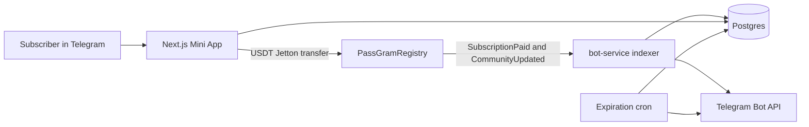

# Architecture

PassGram lets a Telegram channel charge a USDT subscription. The chain splits the payment. The database and the bot learn about that payment by reading events. They do not decide that a wallet submission succeeded.

## Parts

| Path | Role |
| --- | --- |
| `contract/` | Tolk 1.5.0 registry. It stores the community price, duration, and referral rate, checks the owner signature, splits USDT, and emits events. |
| `frontend/` | Telegram Mini App, the owner console at `/admin`, and the HTTP APIs for channels, referrals, wallets, and the webhook. Vercel builds this directory. |
| `bot-service/` | Polls TonCenter, writes confirmed payments and the listed price, creates one-time invites, and removes expired members. |
| `backend/` | Schema and migrations only. There is no separate API process. |

## What is allowed to change state

- A subscriber payment becomes a membership only after the indexer reads `SubscriptionPaid` and the paying wallet is linked to a Telegram user. The invite is created after that write. If that community has no row yet, the indexer logs the transaction and moves on. Any other failure leaves the cursor in place.
- The price and duration shown to subscribers change only after the indexer reads `CommunityUpdated`. Signing `UpdateCommunity` in the wallet does not update the public listing by itself.
- The first community-referral payment locks the marketer and the rate on the contract. Later renewals pay that lock. The database stores the marketer's receiving wallet. It does not choose the rate.
- The app and the indexer accept a registry only when its on-chain code hash equals `contract/registry.codehash`.

## Trust boundaries

Telegram `initData` is checked in `frontend/lib/server/initData.ts`. A user id is taken only from that payload. Wallet ownership is a gasless signature, not a typed address. Database connections from the app and the bot use the database owner. Row security is on so a Supabase anonymous key is not a backdoor.

The owner console at `/admin` is separate from the Mini App. Sign-in is Telegram Login, checked with the bot token, and the Telegram user id must be listed in `PASSGRAM_ADMIN_TELEGRAM_IDS`. The session is a short-lived HttpOnly cookie. The console reads confirmed rows only. It does not show invite links and does not change price, access, or the indexer.

The published testnet registry is older than this source. It does not match the code hash, so this tree will not send it registrations or index it as the current registry. A new deployment is required before mainnet.
